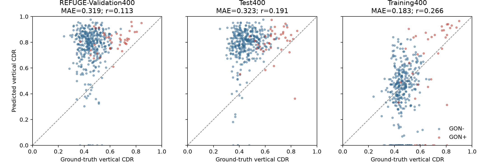

# Rà soát bằng chứng nghiên cứu trước khi viết paper

Ngày: **15/10/2026**. Phạm vi: năm điểm trong mục 1 và protocol OOF.

**Ghi chú phiên bản:** Audit này mô tả code và artifacts trước khi sửa protocol. Các tham chiếu dòng code bên dưới thuộc snapshot cũ có fingerprint trong JSON audit. Entry point OOF và evaluator sau đó đã được thay bằng [protocol v2](../docs/clinical_protocol_v2.md); xem [báo cáo triển khai bước 1](protocol_v2_step1_implementation_report.md) để biết trạng thái kiểm chứng mới.

**Kết luận:** các chỉ số phân loại chính khớp với CSV đã lưu, nhưng chưa đủ bằng chứng cho các phát biểu “vượt trội”, “ổn định toàn hệ thống”, “mỏ neo giải phẫu bất biến” và “an toàn lâm sàng”. Benchmark REFUGE hiện tại không đánh giá cùng pipeline auto-OOF được dùng cho kết quả PAPILA.

Đây là audit của code, dữ liệu và artifacts hiện có. Không huấn luyện lại, không chọn mô hình/ngưỡng bằng test, không thay thế kết quả gốc. Việc tính lại AUC từ CSV không xác thực toàn bộ lịch sử huấn luyện của mô hình.

## 1. Phương pháp và bằng chứng đã kiểm tra

- Tính lại AUC, confusion matrix, sensitivity, specificity, Brier và kiểm tra ngưỡng từ **21 file dự đoán**: M2 (5), fusion oracle (5), fusion auto-OOF (5), DINOv2@224 (3), DINOv2@392 (3).
- Đối chiếu image ID, patient ID, nhãn và độ phủ của từng file với PAPILA test manifest.
- Kiểm tra patient split, nhóm bệnh nhân trong OOF, thứ tự feature/manifest và SHA-256 thực tế của **420 ảnh PAPILA**.
- Tính lại AUC M2, CDR và fusion trên toàn bộ REFUGE và từng phân vùng.
- Đọc **1.200 mask REFUGE gốc**; kiểm tra mã hóa, kích thước ảnh–mask, cách tính chiều cao và CDR ở độ phân giải gốc/256×256.
- Đọc metadata checkpoint M2/fusion, kiểm tra feature cache; suy luận mẫu cố định trên CPU: 4 ảnh PAPILA test và 4 ảnh đầu mỗi phân vùng REFUGE, tổng 16 ảnh.
- Tính lại paired patient-clustered bootstrap (2.000 lần); kiểm chứng phép tính có trọng số bằng cách resample bệnh nhân trực tiếp qua sklearn trên fixture có hai mắt và điểm số bằng nhau (200 lần).

Artifacts:

- [Chỉ số audit JSON](../results/research_claims_audit/audit_metrics.json).
- [21 lần chạy được tính lại](../results/research_claims_audit/classification_runs.csv).
- [Bảng đối chiếu 1.200 mask](../results/research_claims_audit/refuge_mask_audit.csv).
- [Metadata và suy luận mẫu](../results/research_claims_audit/checkpoint_inference_audit.json).
- [Biểu đồ CDR PNG](../results/research_claims_audit/refuge_cdr_scatter.png), [PDF](../results/research_claims_audit/refuge_cdr_scatter.pdf).

## 2. Kết quả rà soát sáu vấn đề chính

| Vấn đề | Trạng thái | Kết luận sau audit |
|---|---|---|
| Fusion tự động so với CNN trên PAPILA | **Đã xác nhận số liệu; so sánh chưa tương xứng** | Mean AUC 0.867270 so với 0.876018 là đúng, nhưng OOF dùng một backbone cố định còn M2 thay seed toàn mạng. Không chứng minh fusion tốt hơn hay kém hơn về mặt phương pháp. |
| Độ ổn định giữa seed | **Đã xác nhận giới hạn** | Std 0.004474 chỉ là biến thiên head trên feature/CDR cố định; không thể so trực tiếp với std khi fine-tune toàn bộ DINOv2 hoặc M2. |
| Pipeline REFUGE | **Đã xác nhận sai khác; cần chạy lại** | Dùng head train với CDR chuyên gia, scaler oracle và đầu vào global 256 thay vì cấu hình train 224. Chưa phải external evaluation của auto-OOF. |
| CDR suy giảm trên REFUGE | **Đã xác nhận trên dự đoán đã lưu** | MAE 0.320786, r=0.151753 trên 800 ảnh validation/test; không giải thích được bằng mã hóa mask, công thức chiều cao hoặc việc resize GT. Chưa xác định nguyên nhân suy giảm. |
| Test PAPILA nhỏ | **Đã xác nhận; giới hạn thiết kế** | 64 mắt/32 bệnh nhân, 13 mắt dương tính từ **7 bệnh nhân**. Không đủ để kết luận an toàn lâm sàng. |
| Sinh OOF | **Đã xác nhận lỗi protocol cross-fitting** | Fold được dự đoán cũng được dùng chọn checkpoint segmenter theo Dice. Cần validation bên trong phần train hoặc số epoch cố định chọn độc lập với fold đó. |

### 2.1. PAPILA: con số đúng nhưng cần phân biệt loại so sánh

| Mô hình | Số seed | Mean AUC | Std, ddof=0 | Ensemble AUC |
|---|---:|---:|---:|---:|
| M2, train lại toàn mạng | 5 | 0.876018 | 0.025922 | 0.882353 |
| Fusion CDR chuyên gia, backbone thay theo seed | 5 | 0.888989 | 0.028114 | 0.906486 |
| Fusion auto-OOF, backbone/CDR cố định | 5 | 0.867270 | 0.004474 | 0.868778 |
| DINOv2@224, full fine-tuning | 3 | 0.812971 | 0.034499 | 0.817496 |
| DINOv2@392, full fine-tuning | 3 | 0.801156 | 0.102217 | 0.889894 |

Không phát hiện sai khác ngoài sai số làm tròn ở các AUC, sensitivity, specificity và calibrated Brier của 21 lần chạy so với các JSON tương ứng. Các dự đoán nhị phân khớp ngưỡng đã lưu.

**Điểm cần bổ sung cho nhận định ban đầu:** backbone cố định mà OOF sử dụng gắn với baseline M2 gốc có AUC **0.837104**, không phải mean M2=0.876018. So với baseline này, năm head auto-OOF có AUC cao hơn khoảng 0.0256–0.0362. Tuy nhiên:

- Với head seed 42, ΔAUC=**+0.036199**, CI95% theo bệnh nhân **[-0.035727, +0.120540]**.
- Cả năm CI của các head so với M2 gốc đều đi qua 0.
- Fusion thay cả head và thêm CDR; chưa có ablation train lại cùng head nhưng bỏ CDR để quy mức tăng riêng cho thông tin giải phẫu.

Vì vậy, có tín hiệu cải thiện trên một backbone cố định, nhưng chưa chứng minh lợi ích CDR có thể lặp lại khi thay backbone seed.

Feature cache không lưu hash checkpoint nguồn; liên hệ với M2 gốc dựa trên tên artifact, metadata và đối chiếu feature bằng suy luận mẫu, chưa phải xác nhận bit-for-bit nguồn gốc feature. Cần lưu provenance này khi tái chạy.

So sánh auto-OOF seed 42 với **M2 multiseed seed 42** cho point ΔAUC=+0.039216 và bootstrap mean Δ=+0.037431, CI [-0.054554, +0.153647]. Đây là hai backbone không đồng nhất; không gộp kết quả này với so sánh M2 gốc.

Nguồn code: `src/run_step6_oof_pipeline.py:428` tải feature một lần và `:448` chỉ lặp seed của head; `src/run_multiseed_evaluation.py:545` train M2 lại rồi `:551` train fusion theo backbone tương ứng.

### 2.2. REFUGE đang đánh giá một cấu hình khác

Đã kiểm tra checkpoint thực tế:

- Global: `outputs/models/M2_global/best_model.pt`, seed 42, checkpoint epoch 11, `image_size=224`.
- Fusion: `outputs/models/M5a_global_cdr/best_model.pt`, variant `M5a_global_cdr`, epoch 14, `hidden_dim=0`.
- Fusion được train từ `papila_morphology.csv`, trường `cdr_mean`, theo `src/train_fusion.py:414`.
- Scaler external tính lại từ CDR chuyên gia train: mean **0.362913**, std **0.157413**; không phải scaler fit trên CDR OOF dự đoán.
- `src/evaluate_zero_shot_refuge.py:197` resize ảnh 256, rồi `:215` và `:217` đưa trực tiếp vào global classifier/feature extractor. Cần giữ preprocessing riêng cho segmenter 256 và global 224.

Không tìm thấy checkpoint auto-OOF được lưu trong cây outputs/results. `train_m5a_auto_oof_seed` giữ head tốt nhất trong RAM rồi chỉ trả predictions/metrics; scaler OOF cũng không được lưu thành artifact. Vì vậy không thể lấy head auto-OOF hiện có để đánh giá external ngay; cần chạy lại phần train head và lưu đủ bundle. Sau khi sửa OOF, cần sinh lại CDR train trước.

**Phân loại kết quả cũ:** external exploratory evaluation của **head train trên oracle CDR, inference bằng predicted CDR**. Nó không mặc nhiên là rò rỉ nhãn REFUGE; vấn đề đã xác nhận là không đồng nhất phương pháp và phân phối feature đầu vào.

AUC tính lại từ CSV vẫn khớp:

| Phân vùng | M2 | Auto-CDR đơn lẻ | Fusion cũ |
|---|---:|---:|---:|
| All 1.200 | 0.6407 | 0.6388 | 0.7544 |
| Test400 | 0.6307 | 0.5512 | 0.7576 |
| Validation400 | 0.7296 | 0.5841 | 0.8078 |
| Training400 | 0.6008 | 0.7101 | 0.7183 |

Đây là kết quả của cấu hình cũ, không phải dự báo kết quả sau khi sửa pipeline.

### 2.3. CDR REFUGE: loại trừ một số lỗi đánh giá, chưa xác định nguyên nhân mô hình

Kết quả từ mask gốc:

| Phân vùng | N | MAE, GT 256 | Pearson r, GT 256 | MAE, GT gốc |
|---|---:|---:|---:|---:|
| Validation400 | 400 | 0.318534 | 0.112811 | 0.317070 |
| Test400 | 400 | 0.323038 | 0.190878 | 0.322990 |
| Training400 | 400 | 0.183007 | 0.265836 | 0.182971 |
| Validation + Test, khớp đánh giá cũ | 800 | 0.320786 | 0.151753 | 0.320030 |
| Toàn bộ, audit bổ sung | 1.200 | 0.274860 | 0.106099 | 0.274344 |

Các mask đều có mã hóa hợp lệ 0=cup, 128=disc ngoài cup, 255=background; kích thước ảnh và mask khớp. Trên 1.200 mask này, đếm số hàng có foreground và lấy vertical span cho cùng CDR. Tính GT ở độ phân giải gốc thay vì 256 cũng không cải thiện đáng kể MAE.

Trên validation/test, median CDR dự đoán **0.8056**, trong khi GT **0.4545**; mean signed error **+0.3040**. Điều này cho thấy nhánh hình thái đang ước lượng lệch mạnh trên dữ liệu đó. Không thể suy ra nguyên nhân là thiết bị chụp, domain shift, nhãn hay một thành phần cụ thể chỉ từ audit này.

**Phát hiện thêm:** hàm tìm mask cũ bỏ sót thư mục `Glaucoma`/`Non-Glaucoma` của Training400, mặc dù đủ 400 mask có sẵn. Vì vậy MAE 0.3208 cũ là trên **800 ảnh**, không phải 1.200. Số MAE 0.2749 bổ sung không thay thế việc báo cáo riêng từng phân vùng. Toàn bộ 1.200 ảnh có 33 mask disc dự đoán rỗng và 85 trường hợp cup có chiều cao 0, theo CSV đã lưu.



### 2.4. OOF và độ ổn định

Patient grouping trong manifest/fold đúng: không có bệnh nhân trải qua nhiều split hoặc nhiều fold OOF. Tuy nhiên, `src/run_step6_oof_pipeline.py:194` chọn checkpoint tốt nhất bằng Dice trên fold OOF rồi `:202` nạp lại checkpoint đó để dự đoán cùng fold.

Đây là **ảnh hưởng từ fold giữ lại vào lựa chọn mô hình**, không phải bằng chứng test PAPILA tham gia cập nhật gradient. Không gọi các feature này là OOF hoàn toàn độc lập với quá trình chọn mô hình.

Cách sửa: mỗi outer fold chỉ được dự đoán sau khi cấu hình/epoch được chốt bằng inner validation của các bệnh nhân còn lại; sau đó có thể refit trên toàn outer-train theo số epoch đã chốt. Hoặc dùng số epoch cố định đã được chọn độc lập từ trước. Không chọn lại bằng Dice của outer fold.

Std nhỏ của head là kết quả hợp lệ trong điều kiện **backbone, segmenter và OOF folds cố định**. Muốn phát biểu độ ổn định toàn hệ thống, phải lặp lại các thành phần ngẫu nhiên tương ứng và so cùng phạm vi với baseline.

### 2.5. PAPILA test và độ nhạy

- SHA-256 của cả 420 ảnh khớp manifest; không có hash trùng trong manifest, image ID trùng hoặc patient overlap giữa train/val/test.
- Test: **64 mắt, 32 bệnh nhân; 13 mắt GON+ thuộc 7 bệnh nhân**.
- Năm head OOF đều phát hiện 12/13 mắt; cùng bỏ sót `RET265OS`. Đây là năm dự đoán trên **cùng 13 mắt**, không phải 65 ca độc lập.
- CI95% percentile bootstrap theo bệnh nhân cho sensitivity seed 42 khoảng **[0.75, 1.00]** (2.000 lần). Với chỉ 7 bệnh nhân có mắt dương tính, khoảng này cũng chỉ mang tính mô tả, không phải bảo đảm triển khai.
- Specificity OOF thay đổi **66.67%–80.39%**. Cần so sensitivity tại điều kiện specificity/ngưỡng chọn trước tương xứng, không chỉ so từng ngưỡng Youden khác nhau.

Giới hạn cỡ mẫu không sửa được bằng chạy thêm seed hoặc bootstrap. Cần tập kiểm chứng độc lập bổ sung. PAPILA test và REFUGE đã được xem kết quả nhiều lần; không mô tả chúng là tập mới chưa từng được dùng để phát triển phương pháp.

## 3. Các giới hạn bổ sung ảnh hưởng đến cách viết paper

1. **DINOv2 external chưa truy vết được:** JSON REFUGE có AUC DINOv2 0.6686/0.7171/0.6916/0.6201 nhưng CSV không có điểm DINOv2 từng ảnh, và script external không chạy DINOv2. Không tìm thấy pipeline/predictions external tương ứng trong repo được rà soát. Các số này chưa tái tính được từ artifacts hiện có; chưa dùng để tuyên bố vượt DINOv2 trên REFUGE. Không suy đoán chúng được tạo ra bằng cách nào.
2. **Không có bằng chứng tương đương thống kê:** ensemble DINOv2@392 có AUC 0.889894, auto-OOF ba seed chung có AUC 0.868778. Paired Δ=-0.021116, CI [-0.116164, +0.054545]. CI đi qua 0 không chứng minh equivalence/non-inferiority; cần biên tương đương được định trước và thiết kế phù hợp.
3. **Bootstrap sign frequency không mặc nhiên là p-value:** các helper hiện lấy tỷ lệ Δ bootstrap ≤0 và đặt tên `empirical_p_value_one_sided`. Trong audit giữ nó dưới tên mô tả, không diễn giải là kiểm định null đã hiệu chỉnh. Giá trị 0 từ 2.000 lần không phải p=0. Phân biệt point ΔAUC với bootstrap mean ΔAUC.
4. **Calibration:** OOF head fit Platt trên logits của chính tập dùng train head. Đây không phải test-label leakage, nhưng là calibration trên điểm in-sample; cần dự đoán cross-fitted cho toàn bộ predictor hoặc tập calibration giữ riêng nếu muốn tuyên bố calibration đáng tin cậy. CDR OOF không làm logits fusion tự động thành OOF.
5. **Khả năng replay còn hạn chế:** suy luận 16 ảnh bằng checkpoint hiện có cho kết quả gần nhưng không trùng hoàn toàn CSV cũ. Trên 12 ảnh REFUGE, max chênh probability M2 khoảng 0.00408, fusion 0.01252; 2 ảnh có CDR khác. Chưa xác định nguyên nhân chênh lệch; không coi đây là tái lập chính xác toàn bộ benchmark. Cần lưu phiên bản thư viện, chế độ số học, preprocessing và môi trường chạy. Không có checkpoint từng seed của auto-OOF/DINOv2 fair để replay đầy đủ.
6. **Mô tả kiến trúc:** head auto-OOF trong code là LayerNorm → Dropout → Linear(1025,1), không phải MLP hai lớp như một số đoạn báo cáo tổng hợp; feature embedding là 1024 chiều, khác spatial feature 576 kênh. Cần mô tả theo code thực tế.

## 4. Các phát biểu nên giữ, sửa hoặc tạm bỏ

| Phát biểu | Xử lý |
|---|---|
| PAPILA split theo bệnh nhân, SHA khớp và không overlap | **Giữ**, trong phạm vi dữ liệu đã audit. |
| Auto-OOF AUC 0.8673 và sensitivity 12/13 trên test hiện tại | **Giữ số liệu**, kèm giới hạn OOF/seed/cỡ mẫu. |
| Fusion tốt hơn CNN trong miền | **Chưa kết luận**; cần so cùng backbone và ablation cùng head bỏ CDR. |
| Toàn hệ thống ổn định hơn foundation model | **Tạm bỏ** cho tới khi lặp toàn pipeline tương xứng. |
| REFUGE AUC 0.7544 là kết quả external của auto-OOF | **Sửa định danh** thành kết quả exploratory của cấu hình oracle-trained head dùng predicted CDR. |
| CDR là mỏ neo giải phẫu bất biến | **Tạm bỏ**; độ chính xác CDR external hiện không ủng hộ phát biểu này. |
| Vượt DINOv2 trên REFUGE | **Chưa xác minh** do thiếu predictions/provenance DINOv2 external. |
| CI đi qua 0 xác nhận tương đương thống kê | **Bỏ diễn giải này**. |
| 92.31% chứng minh an toàn lâm sàng | **Bỏ diễn giải này**; ghi kết quả trên 13 mắt/7 bệnh nhân. |
| Sẵn sàng peer review/edge clinical deployment | **Chưa đủ bằng chứng** từ audit này. Audit không đo lại latency/FLOPs hay đánh giá triển khai thực tế. |

## 5. Công việc tiếp theo theo thứ tự phụ thuộc

1. **Chốt protocol tái chạy:** backbone seed, outer/inner patient folds, preprocessing riêng 224/256, tiêu chí chọn checkpoint, calibration và ngưỡng. Không dùng nhãn external để chọn cấu hình.
2. **Sửa OOF và artifact export:** sinh lại CDR train; lưu checkpoint từng fold/head, ID/fold mapping, scaler, calibrator, threshold, config, thư viện và fingerprint. Assert image ID trước khi ghép tensor feature; audit hiện xác nhận đúng thứ tự nhưng code train chưa tự bảo vệ trước thay đổi thứ tự sau này.
3. **Tách các câu hỏi so sánh:** (a) cùng backbone/head có và không CDR, (b) seed toàn hệ thống, (c) oracle so với predicted CDR. Sửa tên báo cáo để không gộp ba câu hỏi này.
4. **Chạy lại external đúng bundle:** nạp head/scaler auto-OOF thực tế; giữ global 224 và segmenter 256; sửa tìm mask Training400; xuất predictions/segmentation metrics đầy đủ. Khôi phục baseline DINOv2 external có provenance sạch, độc lập với dữ liệu đánh giá; checkpoint MSD pilot đã train trên REFUGE không phù hợp cho kiểm chứng này.
5. **Sau khi có kết quả mới:** paired CI tại cùng điều kiện đánh giá, kiểm tra calibration, phân tích khi CDR giúp/gây hại; chỉ sau đó quyết định hướng contribution. Tập độc lập mới dùng cho kiểm chứng cuối cần chưa được dùng để phát triển phương pháp.

Audit đã hoàn tất trong phạm vi artifacts hiện có. Các lần train lại và external benchmark sau khi sửa protocol **chưa được thực hiện**; không trình bày các số audit như kết quả của pipeline đã sửa.

## 6. Tái chạy audit

Chạy từ thư mục gốc dự án:

```bash
venv/bin/python src/audit_research_claims.py
NO_ALBUMENTATIONS_UPDATE=1 venv/bin/python src/audit_checkpoint_inference.py
```

Audit chính chỉ ghi vào `results/research_claims_audit/`, giữ nguyên predictions, checkpoint và metrics gốc. Các fingerprint đầu vào được lưu trong JSON để đối chiếu lần chạy sau. Phép bootstrap có trọng số đã được đối chiếu với resampling trực tiếp; không bổ sung kiểm định null hay bảo đảm thống kê ngoài phạm vi nêu trên.
